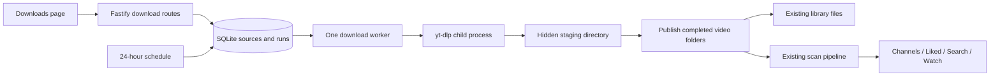

# Integrated YouTube Downloader — Implementation Guide

> **Historical design document** written before implementation and review. Some details
> are out of date: downloads no longer hold the shared background-job lock, and yt-dlp is
> unpinned and auto-updated. See [README.md](README.md) and [HANDOFF.md](HANDOFF.md) for
> current behavior.

Status: implementation present, **unfinished and awaiting the owner's personal testing**.
See [HANDOFF.md](HANDOFF.md) for next-session steps, [README.md](README.md) for usage,
and [VALIDATION.md](VALIDATION.md) for recorded checks and remaining acceptance work.
Prepared: 2026-10-16.
Read this document and [TEST_PLAN.md](TEST_PLAN.md) before coding.

## 1. Outcome and settled decisions

YUI should manage the complete personal archive workflow in its existing application
and Docker container: configure sources, download with yt-dlp, ingest finished files,
and browse/watch them. The downloader is optional; existing scan-only installations
continue to work.

Settled product decisions and planning defaults:

| Topic | Decision |
|---|---|
| Channel/Liked overlap | One physical video can appear in both views. Downloading a duplicate is unnecessary. |
| Quality | Per source: 720p, 1080p, or Best available. Settings affect future downloads only. |
| Existing files | No automatic upgrades, replacements, reorganizing, or deletion. |
| First download | Planner's recommended simple choice: all available videos, or videos uploaded on/after a chosen date. |
| Design | DRY and KISS. Reuse the scanner, database, API, UI conventions, and job reservation. |
| Delivery | Implementation follows this guide; executed checks and remaining acceptance work are recorded in `VALIDATION.md`. |

The date choice is a deliberate simplification of the earlier “recent/new only”
proposal. It is an inclusive **video upload date** filter, not a playlist-add date or
like date. There is no separate subscription baseline or “latest N” feature in V1.
Liked Videos uses all available entries, so liking an old video still works.

### V1 scope

- Sources: YouTube channel Videos tabs, ordinary YouTube playlists, one account's
  Liked Videos playlist, and one-off video URLs.
- Source management, per-source quality and destination, enable/disable, Run now.
- One shared, configurable schedule, default interval 24 hours, initially disabled.
- A durable, sequential download queue and bounded job history/logs.
- Cancellation, explicit retry, and truthful recovery after process/container restarts.
- Cookie upload/replacement and status. Public sources can run without cookies.
- Import of the supplied URL lists and compatible yt-dlp archive text.
- Automatic ingestion of completed downloads, including successful files from partial runs.
- Shared storage for videos that are also liked, with stable liked membership/order.

### Excluded from V1

Multiple accounts/users, OAuth login, per-source cron expressions, parallel source
workers, Redis/another queue service, quality upgrades, transcoding, auto-deletion,
playlist browsing pages, full subscription mirroring, plugins, arbitrary yt-dlp flags,
a browser filesystem picker, notifications, and an in-app yt-dlp self-updater.
Cancellation/restart recovery need not resume partially downloaded bytes. Completed
files must survive; retry may download unfinished files again.

## 2. Verified starting point

Read current code rather than assuming older milestone documents are accurate.

| Existing code | Reuse or required change |
|---|---|
| `backend/src/services/scan-orchestrator.ts` | Existing ingestion, metadata parsing, thumbnails, FTS, and scan logs. |
| `backend/src/services/scan-service.ts` | Shared manual/scheduled scan entry; currently returns a boolean and runs in the background. Add a way for internal callers to await scan completion. |
| `backend/src/lib/background-job.ts` | Single-process reservation shared by scans, metadata, and channel-image jobs. Extend its use to downloads and relevant maintenance writes. |
| `backend/src/services/scan-scheduler.ts` | Existing 48-hour optional scan schedule. Preserve its behavior and tests. |
| `backend/src/services/database-service.ts` | One `Video` per YouTube ID, physical file selection, liked-order assignment. |
| `backend/src/services/liked-video-order-service.ts` | Reuse as the central liked-membership/order service after the migration below. |
| `backend/src/routes/library.ts` | Channels already query by uploader. Liked currently filters `mediaType`, which must change. |
| `backend/src/services/metadata-fetcher.ts` | Already invokes yt-dlp; currently builds a shell command. Reuse common process/configuration code, not that shell-string approach. |
| `backend/src/services/channel-image-downloader.ts` | Existing argument-array yt-dlp invocation. Share tool configuration. |
| `backend/src/lib/auth.ts` | Existing single-admin password gate. Reuse it. |
| `frontend/src/App.tsx`, `components/Layout.tsx`, `lib/api.ts` | Add route/navigation/API methods using current conventions. |
| `Dockerfile`, `docker-compose.yml`, `docker-entrypoint.sh` | Single container, persistent SQLite/config; current media bind mount is read-only. |

`full` and `incremental` currently walk the same general scan pipeline. Do not add a
new incremental scanner or rewrite ingestion for this feature.

### What the supplied scripts establish

References are in [youtube/](youtube/):

- `download_videos.sh`: 7 Best sources, 13 capped at 1080p, 11 capped at 720p;
  23 channel Videos URLs and 8 ordinary playlists in total.
- `download_liked.sh`: account Liked Videos (`https://www.youtube.com/playlist?list=LL`),
  Best quality.
- `ondemand.sh`: one-off downloads, historically capped at 1080p.
- All use one `archive.txt`; the supplied snapshot has 4,022 unique `youtube <id>` entries.
- Downloads include thumbnails, info JSON, descriptions, and available English subtitles
  (`en.*`). Automatic captions are not enabled by these scripts.
- The logs only record that each script finished, not whether its downloads succeeded.

Do not execute/import the shell scripts themselves. Read URL/archive files as data.
Counts above describe the supplied snapshot, not application constants or test fixtures.

**Reference hygiene:** the folder contains a real-looking `cookies.txt` session file.
Do not print, commit, embed in fixtures, or copy it into an image. Before staging the
implementation, add Git/Docker exclusions for private reference cookies, runtime
`.downloads` directories, and staging directories. No cookie values belong in docs.

## 3. Architecture: one worker, ordinary database rows

Keep the existing Fastify process. It owns a small download scheduler and a single
worker that launches yt-dlp child processes. Browsing/streaming stays available.
Use SQLite/Prisma for source definitions, schedule state, and run history; files hold
cookie data, the compatible archive, bounded logs, and completion receipts.



Suggested modules, not a requirement to create a class for every noun:

- `services/download-service.ts`: settings/source operations, enqueueing, worker lifecycle,
  schedule tick, finalization, and scan handoff. Split only if it becomes unwieldy.
- `services/yt-dlp-runner.ts`: argument-array process execution, progress, cancellation,
  common tool arguments. This is the only process-launching implementation for yt-dlp.
- `services/download-storage.ts`: path validation, archive import/update, completion
  receipt validation/publication, and bounded work files.
- Existing `liked-video-order-service.ts`: liked membership/order operations.
- `routes/downloads.ts`, `pages/DownloadsPage.tsx`, and a few focused UI components.

Avoid a generic workflow engine, generic collection system, event bus, repository
framework, or abstraction over multiple download providers. Small pure helpers for URL
normalization, format selection, output templates, and state transitions are useful.

## 4. Data model

Use four small new tables. Names below are suggested; keep equivalent responsibilities.
All timestamps follow the current project's UTC ISO-string convention unless deliberately
changing it everywhere within these new tables.

### `DownloadSettings` — singleton row

- `id = 1`
- `scheduleEnabled` boolean, default false
- `intervalHours` integer, default 24, range 1–8760
- `nextRunAt` nullable UTC timestamp

The downloader's settings live here, not in a second copy in `config.json`. Existing
library paths/options remain in config. `GET /api/config` does not become a second
settings editor for this feature.

### `DownloadSource`

- Stable ID, display name, normalized URL.
- `kind`: `channel`, `playlist`, or `liked`.
- `quality`: `720p`, `1080p`, or `best`.
- `libraryPath`: existing configured destination library root.
- `enabled`: included in scheduled runs; default true when creating a source.
- `useCookies`: default false for public sources, always true for `liked`.
- `uploadedAfter`: nullable `YYYY-MM-DD`; must be null for `liked`.
- `position`: deterministic execution order.
- Creation/update timestamps.

A library is still a filesystem root, not a source. Many sources can target one library.
No new `playlist` library media type is needed. At most one Liked source exists in V1.
Reject duplicate normalized source URLs. Aliases for the same channel need not be resolved
through a network request on creation; the shared archive still prevents duplicate files.

### `DownloadRun`

One row represents one source attempt or one one-off video attempt.

- Stable ID; nullable source reference (`onDelete: SetNull`); trigger `manual`/`scheduled`/`retry`.
- Immutable, validated settings snapshot: source kind/name/URL, quality, destination,
  cookies usage, date filter. A one-off snapshot has target kind `video`, without creating
  a saved `DownloadSource`. Do not store cookie contents in snapshots.
- `status`: `queued`, `running`, `cancelling`, `succeeded`, `partial`, `failed`,
  `cancelled`, or `interrupted`.
- `phase`: preparing/discovering/downloading/finalizing as applicable.
- Created/started/ended timestamps, exit code, bounded error summary, published-file count.
- `scanStatus`: `not_needed`, `pending`, `running`, `complete`, or `failed`; optional last
  scan ID and scan error. Download and scan outcomes are separate.
- Finalization state sufficient to distinguish unapplied completion receipts from an
  already finalized attempt. Work/log paths are derived from the run ID, not client input.

Progress can stay in memory and be polled; persist transitions/results, not every chunk
or percentage. Do not add a per-fragment/per-video job table for this version.

Enforce no more than one queued/running/cancelling run per source. A partial unique
SQLite index in the migration is appropriate. The enqueue service must also handle
repeat requests idempotently. One-off duplicates are deduplicated by normalized video
ID while queued/running; completed duplicates are prevented by the archive/inventory.

### `LikedVideo` — membership independent of a file

- `videoId`: primary key, validated YouTube ID.
- `likedOrder`: nullable integer; ascending means older first.
- `firstSeenAt`: timestamp for local discovery, **not** a claimed YouTube “liked at” time.

There is deliberately **no foreign key requiring a `Video` row**: a liked ID can be
observed before its file exists, and must survive an interrupted download or an index
rebuild. This table is the single authority for liked membership/order.

Keep `Video` as the one physical playback record per YouTube ID. Keep `Video.mediaType`
and `libraryPath` for storage/scanner compatibility; neither determines liked membership.
Do not add a duplicate `Video.isLiked` flag or a generalized collection hierarchy.

Use a small, parameterized SQL join between `liked_video` and `video` for liked browsing,
counts, and ordering. This avoids both an artificial foreign key and thousands of IDs
in a Prisma `in` array. The existing project already uses parameterized raw SQL.
Restrict sort direction to a server-side enum; bind pagination values.

## 5. Liked overlap, order, and migration

### Migration

Create memberships for existing `Video` rows whose `mediaType` is `liked_videos` **or**
whose legacy `likedOrder` is non-null. Preserve their numeric orders, including nulls.
The second case captures already-seen duplicates stored under a channel library.

Retain the legacy `video.liked_order` column for an additive migration, but exclude it
from generated client use with Prisma `@ignore` or an equivalent explicit compatibility
approach. After backfill, all runtime reads/writes use `LikedVideo`; never dual-write.
Review `MigrationService`'s existing liked-order setup so it does not re-backfill or
reassert the old semantic model every startup. Existing API details that expose
`likedOrder` should obtain the current value from the new table.

Preserve video IDs, physical paths, watch progress, thumbnails, and existing channel rows.
Do not move files to make their directories match their memberships.

### Detect likes even when downloading is skipped

Before downloading the Liked source, enumerate its IDs and order with an authenticated,
flat playlist extraction. This discovery request must **not** use the download archive,
date filters, or “stop at first archived item.” Otherwise already-downloaded channel
videos will never become liked.

Capture the discovery result as a durable run work file. Validate/deduplicate IDs;
ignore unavailable placeholder entries without a valid ID. Apply a complete, successful
snapshot through the liked service before starting media downloads. Existing local
channel files then appear in Liked without another download or relocation.

Do not apply a partially parsed, cancelled, or failed enumeration as an authoritative
ordering. Leave current membership/order intact, fail that source attempt, and expose
the error. An empty authenticated playlist is allowed only when extraction completed
successfully; missing/invalid authentication is not treated as an empty playlist.

### Simple archival semantics

YUI is an archive. Unliking/removing a video on YouTube does not delete its local file
or remove a previously recorded liked membership in V1.

For a complete Liked snapshot:

1. Preserve previously known IDs absent from the new snapshot, in their prior order
   (null-order entries last, then video ID as a stable tie-breaker).
2. Append the current snapshot in oldest-to-newest playlist order, deduplicated.
3. Assign sequential ranks to that combined list in one transaction.

Thus current likes follow their YouTube order, while historical likes no longer
returned by YouTube remain before the current list. This is an explicit product rule,
not a reconstruction of unavailable like timestamps. Verify the extractor's actual
playlist ordering in the live smoke test; do not sort by upload date or filesystem order.

The existing text order import remains supported through the same liked service.
It can upsert valid IDs even before their media is indexed. A later successful account
sync applies the ordering rule above; explain this on the import widget.

Scanning a legacy `liked_videos` directory records membership idempotently regardless
of whether `DatabaseService` inserts, updates, or skips the physical video row. Unknown
IDs get an appended order; known membership/order is preserved. Scanning a channel
library must never clear likes. Update both `/api/library/liked` and the old liked
fallbacks in related/navigation queries; do not leave them dependent on media type.
Channels continue to query by uploader; watch progress remains one row per video.

Generic storage statistics grouped by `mediaType` may remain storage statistics. Label
them accordingly; a liked count is a separate membership count and need not sum with
channel counts to the total. Avoid duplicating results in Home or Search.

## 6. Scheduling, queue rules, and job coordination

### Schedule

- A single global download schedule defaults to 24 hours and is initially off.
- Enabling/changing the interval sets the first deadline to now + interval. Run now is
  explicit and available without enabling the schedule.
- Saving unchanged settings preserves the deadline; disabling clears it.
- Tick about once a minute. In a single DB transaction, enqueue enabled sources that
  have no active attempt and advance the next deadline from the actual enqueue time.
- Missed intervals create one batch of eligible source attempts, not a backlog.
- Preserve source ordering. The migration import order is Best, 1080p, 720p, then Liked,
  matching the existing channel script's precedence and the recommended initial cycle.
- Disabling a source cancels its queued attempt(s), lets its active attempt finish,
  and excludes it from future schedules. Run now may deliberately run a disabled source.
- Edits affect newly enqueued runs. Queued snapshots stay fixed; cancel/requeue to apply
  changed settings. Block source deletion while its run is active; cancel queued runs
  before deleting, and retain completed history via the snapshot.

### Reservation and scan handoff

Use the existing background reservation for the entire active download attempt,
including liked discovery and publication. Only one download attempt runs at once;
manual/scheduled scans, metadata jobs, and channel-image jobs wait or return their
existing conflict response. Queued downloads do not themselves hold the reservation.

Reuse scan execution rather than calling YUI's own HTTP endpoints. Refactor
`scan-service.ts` minimally so callers can acquire the reservation and await a scan,
while the existing manual route still returns immediately. Keep one implementation
of scan state/error/finally cleanup. Never call a second lock-acquiring scan entry
while already holding the download reservation.

Before publishing the first completed file, durably set that run's `scanStatus=pending`.
When the download queue drains, coalesce pending runs by destination library and scan
each affected active library once. Await scan completion and update only the captured
run IDs. This avoids scanning the same channel root after every source or every video.
Manual/periodic scans remain available between attempts. They need not clear these
pending flags; an extra reconciliation scan is acceptable in V1.

A scan failure does not turn a successful download into a failed transfer. Show
“Downloaded; scan failed” with a retry-scan action that does not run yt-dlp again.
Persist pending scan work so a restart cannot lose the handoff. Check the returned
`ScanResult.errors`, not just whether the scan promise resolved.

The existing optional 48-hour scan schedule stays independent, useful for external
files. The download worker must honor its reservation and must not rewrite its deadline.
A skipped/missing destination library prevents a download from starting. If it becomes
skipped before scan handoff, leave the scan pending with an explanation until enabled.

Library path edits/removals must reject changes that would invalidate active or pending
publication/scan work. Source destinations must be updated before removing a referenced
library. No full library-ID migration is necessary; validated canonical paths suffice.

### Failure, retry, and shutdown

- `yt-dlp` uses bounded transport/fragment retries. Do not add an unbounded app retry loop.
- Explicit retry creates a new attempt with the same snapshot after resolving any pending
  publication from the old attempt. Completed files are skipped through the archive.
- Non-zero exit with published successes is `partial`; with no successes, `failed`.
  Exit zero with no downloads is a valid success, for example all items already archived.
  Publication/receipt failures also prevent `succeeded`, even if yt-dlp exited zero:
  report partial when some files were published, otherwise failed. Explicit cancellation
  and interruption retain their respective status and separately show published successes.
- Cancellation of a queued run is immediate. For an active run, set `cancelling`, stop
  the child process group (including ffmpeg), wait for exit, and finalize valid completed
  files before releasing the reservation. Do not delete completed library files.
- On server shutdown, stop timers/new claims, terminate and reap the active process group
  with a bounded grace period, persist interruption/pending work, then close the server.
  The current `process.exit(0)` hook must await this cleanup; do not leave orphan children.
- On startup after migrations, mark old active/cancelling runs `interrupted`, recover
  completed receipts, and service pending scans before taking new queued downloads.
  Queued jobs survive and may resume. Interrupted attempts remain visible and retryable;
  the next scheduled attempt may also retry unfinished content normally.
- Failed publication recovery stays visible and retains its work files. Try recovery on
  startup and explicit retry, not in a tight loop that blocks the UI or fills the logs.

## 7. Files, archive correctness, and scanner safety

### Persistent locations

Default runtime state directory: `.downloads` beside the active config file, resolved
from `getConfigPath()`, with an optional `DOWNLOAD_STATE_DIR` environment override.
In the usual container this is `/config/.downloads`.

```text
/config/.downloads/
  cookies.txt                  private runtime credential file
  archive.txt                  shared yt-dlp-compatible history
  runs/<run-id>/
    archive.txt                attempt-local archive copy
    completed.jsonl            completed-file receipts
    liked-snapshot.json        only for Liked discovery, when applicable
    output.log                 bounded, redacted process log

<destination-library>/.yui-staging/<run-id>/
  ...                          complete and incomplete yt-dlp output folders
```

The hidden staging directory is inside the destination filesystem so publication can
use same-filesystem rename. The scanner already skips hidden directories; retain and
test that behavior. Never configure this staging directory as its own library.

### Output layout

Keep the current layouts, relative to the selected library root:

Channel-style destinations:

```text
%(channel)s/%(upload_date)s - %(title)s [%(id)s]/%(upload_date)s - %(title)s [%(id)s].%(ext)s
```

Legacy liked-style destinations:

```text
%(channel)s - %(upload_date)s %(title)s [%(id)s]/%(upload_date)s  %(title)s [%(id)s].%(ext)s
```

Select the layout from the destination library's existing type. Allow a Liked source
or one-off download to use either library type; actual liked membership is independent.
A one-off video in a channel-style library is not automatically liked. A legacy liked
folder retains its established scanner behavior of adding membership.

Require a configured, existing, active, writable destination root. Do not create a
missing library root automatically. Resolve/check paths again when a job runs and
before publication, including symlink/path containment. Server-owned templates and
work paths cannot be overridden with request fields or arbitrary CLI arguments.

### Publication and archive commit

This ordering is essential; a raw shell-script wrapper is insufficient:

1. Prepare an attempt-local archive from the shared archive plus currently verified
   indexed local video IDs. Existing files win regardless of a new source's quality.
   Check file existence; do not blindly treat stale database rows as present.
2. Run yt-dlp into hidden staging, using the attempt-local archive. **Do not let the
   child write the authoritative shared archive directly.**
3. Use yt-dlp's machine-readable `after_move` completion output to append a durable
   JSONL receipt for each finished file. Suggested template, passed as one argument:
   `after_move:{"id":%(id)j,"filepath":%(filepath)j}` with `--print-to-file`.
   Explicitly use `--no-simulate`; printing must not accidentally disable downloads.
   Verify this template against the pinned release's
   [output-template behavior](https://github.com/yt-dlp/yt-dlp#output-template).
4. On process exit, process valid complete receipt lines even if the source failed or
   was cancelled. Validate IDs, paths, final media, and required info JSON. An incomplete
   last JSONL line after a crash is not a successful item.
5. Persist pending scan work, then rename each completed video folder into its final
   location. Move the media and its sidecars together; do not expose separate video/audio
   fragments as playable library items. Do not overwrite an existing destination.
6. Add only successfully published or verified already-present IDs to the shared archive,
   writing its deduplicated union atomically. Never merge the attempt archive wholesale:
   yt-dlp may record a staging success whose publication subsequently failed.
7. Mark finalization complete only after these steps. Pending scan processing follows
   section 6. Clean owned staging/work files only when no recovery depends on them.

The receipt and run state make publication replayable. In particular, if the process
crashes after rename but before archive commit, recovery validates the expected final
file and commits its archive entry without downloading again. If staging remains,
recovery publishes it first. A destination collision with inconsistent metadata is an
explicit error, not permission to replace/delete files. Keep records needed to repair it.

The import archive is a deliberate historical skip list: an imported ID whose local
file is absent remains skipped, and is not represented as a playable video. Do not
silently redownload the user's historical archive or invent database videos from it.
“Repair missing archived files” is outside V1.

A run completing with zero new files does not require a post-download scan. Liked
membership updates against existing videos are immediately queryable through the join.

### Scanner issue to fix as part of this integration

Currently `Scanner.walkLibrary()` logs directory-read failures and continues; an empty
result can reach missing-file reconciliation. Propagate scan completeness/read failures
so an unreadable root or subtree cannot mark unseen videos missing. Reconcile missing
files only for successfully traversed libraries, conservatively skipping reconciliation
for a library with traversal errors. Preserve the existing protection for skipped
libraries. Test this with filesystem failures, not only mocked successful walks.

## 8. yt-dlp invocation and runtime

Launch a fixed configured executable with `spawn(executable, args, { shell: false })`.
Stream stdout/stderr with line buffering that handles split chunks, UTF-8 boundaries,
and bounded long lines. Do not use `exec` shell strings, `--exec`, or shell interpolation.
Use an argument terminator before the normalized URL where supported.

Common source options preserve current behavior:

- Write thumbnail, info JSON, description, and available `en.*` subtitles.
- Use the attempt archive and server-generated staging output template.
- Ignore ambient yt-dlp configuration so host/container defaults cannot inject behavior.
- Explicit JS runtime, no color, machine-readable progress, bounded retries/timeouts.
- Do not wait indefinitely for upcoming videos; exclude active/upcoming livestreams.
  Completed livestream recordings remain eligible. Verify the chosen filter with fixtures.
- Do not use flags that hide errors or falsely force archive entries for failed media.

Quality mapping:

| Choice | Format policy |
|---|---|
| Best | Preserve yt-dlp's normal best-quality selection. |
| 1080p | `bv[height<=1080]+ba/b[height<=1080]` |
| 720p | `bv[height<=720]+ba/b[height<=720]` |

These are height caps and preserve the supplied scripts. A lower available resolution
is valid. Do not silently exceed the cap, force H.264, transcode, or reinterpret Best as
1080p. A quality change never re-downloads an already archived video. When sources
overlap, the first successful download wins; deterministic source order is the tie-breaker.

For channels/playlists with a date filter, pass validated `YYYYMMDD` to `--dateafter`.
The filter remains active on future runs. Explain upload-date semantics in the UI,
particularly that an old video newly added to a playlist can be excluded. Missing dates
must follow a tested, documented policy: skip such entries when a cutoff is configured,
with a diagnostic; do not silently download unknown-date items outside the selected scope.

Accept only supported YouTube HTTP(S) URLs, canonicalize to HTTPS, remove irrelevant
tracking parameters, reject URL credentials, nonstandard ports, other hosts, file URLs,
and option-like input. Support normal watch URLs, `youtu.be`, Shorts video URLs, channel
handles/IDs, and playlist IDs. Explicitly chosen one-off videos use `--no-playlist` even
if their original URL contains a playlist parameter. Normalize bare channel URLs to their
Videos tab. Do not use the old script's `watch?v=` substring heuristic.

Progress shows phase, current item, available bytes/speed/ETA, and confirmed published
count. Unknown totals stay unknown. Do not claim exact skipped/error totals by scraping
human terminal messages. Persist exit codes and a useful bounded error summary.

### Docker toolchain

Use a supported Node runtime consistently across the image stages (Node 24 LTS is the
intended baseline; validate it with the existing builds). Current EJS requires Node 22+
and explicit Node selection. Install a tested, pinned yt-dlp release with its matching
EJS dependency set in a Python virtual environment, expose it on PATH, and keep ffmpeg.
Use the package's `default` dependency group for EJS. Select and record the exact tested
release during implementation; no floating runtime self-updates or unverified package mix.
See the official [EJS setup requirements](https://github.com/yt-dlp/yt-dlp/wiki/EJS).

This replaces relying solely on Alpine's yt-dlp package version. A bundled matching EJS
package avoids requiring `--remote-components ejs:github` at runtime. Share the same
executable/runtime configuration with existing metadata and channel-image operations.
Keep their behavior intact while removing duplicated tool configuration/shell execution.

Retain the project's pinned pnpm version and explicit build-script policies. Add a
read-only tool-status response with actual versions and availability; no update endpoint.
Add `init: true` and a suitable stop grace period to Compose, and test descendant cleanup.
Document a writable media mount for downloader destinations while retaining read-only
mount examples for scan-only libraries. No NAS-specific absolute paths in application code.

## 9. Cookies and access

One cookie file supports the one account in V1. Upload Netscape-format text through an
API route with a small explicit body limit (1 MiB is sufficient initially). A JSON
`{ content }` upload from a browser FileReader matches the existing text-import pattern;
no multipart dependency is needed. Validate format and size without logging the contents.
Write atomically with restrictive permissions into the private runtime directory.

GET returns only presence/last-modified information, never contents. Uploaded does not
mean currently authenticated. Liked jobs require cookies; public jobs use them only if
selected. Failed authentication must surface as a failed attempt, with guidance to
replace cookies; do not promise automatic browser-cookie refresh or account login.

Because yt-dlp can update its cookie jar, serialize cookie replacement/deletion with the
background reservation and reject it while a relevant job is running. No credentials
in config JSON, source snapshots, logs, progress, exceptions returned to the browser,
or static assets. Redact authenticated/signed URL query data from logs as needed.

Reuse the application's current password gate rather than inventing roles. Keep trusted
local, auth-disabled use supported. Fix the existing auth helper's failure-open behavior:
a config load error must not disable authentication and expose writable/credential routes.
Return an error until config can be loaded, and cover this regression in API tests.

## 10. API and Downloads page

Use `/api/downloads` as a focused route group. Zod validates every mutation. Do not write
unvalidated settings to disk or enqueue a run before validation finishes.

| Endpoint | Purpose |
|---|---|
| `GET /settings`, `PUT /settings` | Shared schedule settings and next deadline. |
| `GET /sources`, `POST /sources`, `PATCH /sources/:id`, `DELETE /sources/:id` | Source management. |
| `POST /sources/:id/run` | Enqueue one source; return existing active run if already queued/running. |
| `POST /run` | Enqueue all enabled sources, deduplicated, in source order. |
| `POST /videos` | Enqueue a one-off video with explicit destination/quality/cookies usage. |
| `GET /runs`, `GET /runs/:id` | Paginated history and current progress/results. |
| `GET /runs/:id/log` | Bounded log tail; offset/limit or a fixed tail, never an unbounded file dump. |
| `POST /runs/:id/cancel`, `POST /runs/:id/retry` | Safe, repeatable control actions. |
| `POST /runs/:id/retry-scan` | Retry pending/failed ingestion without another download. |
| `GET /cookies`, `PUT /cookies`, `DELETE /cookies` | Credential presence/upload/removal. |
| `POST /import/preview`, `POST /import` | Validate/preview source lists and archive, then apply an explicit import. |
| `GET /tools` | yt-dlp/runtime/ffmpeg availability and versions. |

Paths in this table are relative to `/api/downloads`. Use 400 for invalid data, 404 for
missing IDs, 409 for incompatible active operations, and 202 for newly queued work.
Responses contain a consistent error string and useful field details. Busy download
requests can queue; do not conflate “queued” with “currently downloading.”

The page at `/downloads` uses the existing navigation/design language and contains:

1. **Sources**: name/URL, kind, quality, destination, enabled state, last result; Add,
   Edit, Run now, Disable, Remove. Liked is an explicit source kind.
2. **Queue / Activity**: active phase/progress, waiting jobs, cancel/retry, scan status,
   and a collapsible bounded log. Show the other background job when work is waiting.
3. **Schedule / Setup**: schedule toggle/interval/next run, cookie status/replacement,
   tool status, import, and a compact one-off URL form.

Do not redesign the existing Configure page. Link to its library manager when no
writable destination is configured. Remove or hide its currently unsupported `playlist`
and `watch_later` library-type options when touching that control; source types are
separate from storage types.

Use polling, approximately 2 seconds while active and 10 seconds while idle. Reuse the
API helper and error handling. No WebSockets/SSE requirement. Failed loads need a retry
path; saving errors must preserve edited fields. Format schedules in the user's locale.
The page must work on mobile and with keyboard/labelled controls.

## 11. Migration, import, and maintenance

### Existing NAS installation

1. Back up the SQLite database, config, and NAS archive file.
2. Deploy the feature with its schedule disabled. Migrate the database additively.
3. Configure the existing channel/liked library roots using container paths and grant
   write access only to intended download destinations.
4. Run a successful scan of those existing libraries before enabling downloads. This
   establishes local inventory, preserves watch progress, and backs up archive deduplication.
5. Import the three text lists with their quality groups. Trim whitespace/comments,
   validate every URL, and preview duplicates/conflicting quality settings. Do not silently
   resolve conflicting duplicates. Import Liked explicitly with its destination/cookies use.
6. Import `archive.txt` as a validated, deduplicated union, never replacement. Accept only
   supported `youtube <11-character-id>` entries in V1; report invalid lines. Preserve the
   original file as a backup and never edit the reference copy in `docs/`.
7. Upload cookies through the private runtime API. For faithful migration, imported
   sources can have cookies enabled as in the original scripts.
8. Disable the external cron jobs before the first real YUI download. Two independent
   downloaders must not write the same library/archive during cutover.
9. Run one source, then Liked; verify duplicate skipping, overlap, and scan results.
   Enable the 24-hour schedule after this succeeds.

Import is idempotent, does not start downloads or enable scheduling, and does not execute
file contents. Acquire the reservation while mutating the archive. Include imported,
skipped, and invalid/conflicting counts. A completed import must not be reported if
an archive write failed; DB/filesystem work should be retry-safe even without a shared
cross-filesystem transaction.

### Fresh installation

Create/select a writable destination library, add sources/quality/history choices, add
cookies if needed, then Run now or enable scheduling. No old files or NAS scripts are
required. The app supplies defaults; it must not hard-code the owner's channel list.

### Cleanup and existing destructive tools

Keep at most a documented bounded number of finalized terminal run logs/history entries
(e.g. 100), with a per-run log cap (e.g. 10 MiB). Never prune unresolved publication or
pending scan records/work files. Staging cleanup can only remove the worker's validated,
owned staging directory after the child exits and successful receipts are finalized.
It must never remove published media, configured library roots, cookies, or the archive.

The current Danger Zone reset needs the same job reservation. Refuse a reset during
active downloads/scans. Clearing the browser index should preserve download settings,
sources, archive, liked membership, and recovery data; make that behavior explicit in
its copy. A rescan can rebuild video rows and recover membership without downloading.
Do not introduce automatic media deletion or a destructive downloader reset in V1.

## 12. Implementation sequence and completion gates

Implement in reviewable steps, running relevant tests at each step. These are dependencies,
not separate optional features that can be silently left out.

1. **Fixtures and foundations**: protect reference secrets from staging/build context;
   add isolated test helpers and a fake yt-dlp executable; migrate the four tables;
   establish settings/source validation and path/format helpers.
2. **Liked membership**: backfill and move order authority; update scanner, liked queries,
   counts/import, and related fallbacks. Prove an existing channel file appears in Liked
   with unchanged path/watch progress, and that scan-only use still works.
3. **Runner and storage**: toolchain setup, common process adapter, bounded logs/progress,
   hidden staging, receipts, publication, archive import/commit, and cancellation.
4. **Queue and schedule**: persistent enqueue/claim rules, source ordering, scheduler,
   graceful shutdown/recovery, and coalesced scan handoff. Fix traversal-error reconciliation.
5. **API and UI**: Downloads page, one-off URLs, credentials, import preview/apply, and
   failure/retry states. Keep mutation paths centralized in the service.
6. **Deployment and acceptance**: clean Docker builds, migration/fresh-install exercises,
   bounded live yt-dlp checks, and the regression suite in [TEST_PLAN.md](TEST_PLAN.md).
   Update README/DOCKER/API docs and report exact checks and limitations.

Required handoff from the implementing model: changed files, migrations, commands/results,
any remaining failing tests or unverified live behavior, and concrete NAS cutover steps.
Do not call the feature complete based only on TypeScript compilation or mocked tests.
Do not point tests, reset commands, or download probes at the owner's real database,
configured archive libraries, or supplied cookies. Live acceptance uses a dedicated test
library and user-provided test credentials when authenticated validation is needed.

## 13. References and verification notes

Repository scripts and implementation were inspected directly. Upstream behavior was
checked against official yt-dlp documentation on 2026-10-16; recheck version-dependent
runtime/CLI details while implementing.

- [yt-dlp README](https://github.com/yt-dlp/yt-dlp): format selection, archive behavior,
  structured progress/completion output, date filtering, and flat playlist extraction.
- [EJS setup](https://github.com/yt-dlp/yt-dlp/wiki/EJS): supported runtimes and installation
  with `yt-dlp[default]`; current Node minimum is 22 and Node must be explicitly enabled.
- [YouTube cookies](https://github.com/yt-dlp/yt-dlp/wiki/Extractors#exporting-youtube-cookies):
  cookie export/rotation and authenticated extraction. YUI provides credential management,
  not a guarantee that YouTube authentication/extraction will remain valid indefinitely.

The queue, schema, publication protocol, ordering rule, and UI in this guide are design
choices for YUI. They are not claims that upstream yt-dlp implements those application
behaviors automatically.
